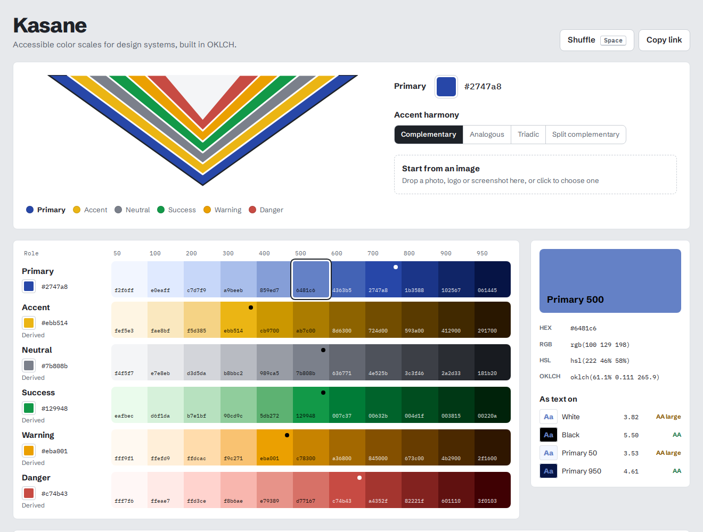
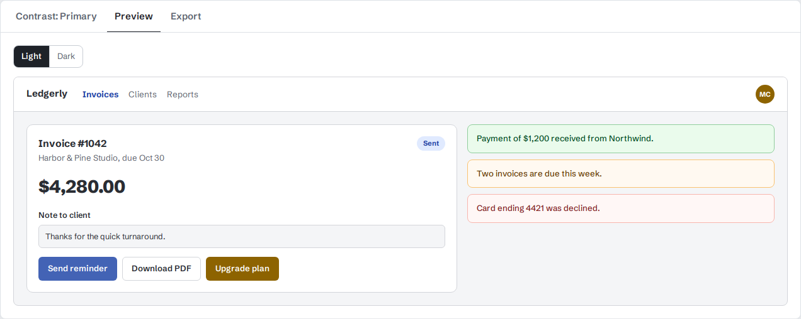

# Kasane

Accessible color scales for design systems, built in OKLCH.

**Live:** https://kasane.mycodedojo.com



Pick one primary color (or drop in an image) and Kasane builds a six-role palette, with primary, accent, neutral, success, warning and danger, as 11-step scales (50–950). It shows the WCAG contrast of every step, previews the palette on a real product screen in light and dark mode, and exports Tailwind v4, Tailwind v3, CSS variables, SCSS or W3C design tokens.

The name comes from *kasane no irome*, the Heian-court practice of layering colored robes so that each color is read against the next. The layered collar at the top of the app is the same idea: every color in your system, seen against its neighbors.

## What's interesting under the hood

All of the color math is in [`src/color/`](src/color), written from scratch with no color library, and covered by 31 Vitest tests.

- **Perceptual scales.** Steps are spaced by OKLCH lightness, not HSL, so the 500 of a yellow and the 500 of a blue look equally light. Your base color lands *unchanged* on its nearest step. The offset from that step fades toward both ends so the scale stays strictly monotonic. Chroma tapers toward the tints and shades, and yellows drift toward orange as they darken, like pigment, instead of turning olive. ([`scale.ts`](src/color/scale.ts))
- **Gamut mapping.** Many OKLCH colors can't be shown in sRGB. Out-of-gamut steps are brought in by binary-searching chroma while lightness and hue stay fixed (the CSS Color 4 approach), so a step never jumps in lightness or hue. ([`convert.ts`](src/color/convert.ts))
- **Image extraction.** The image is downscaled to about 96px and clustered with k-means++ in OKLab, where straight-line distance tracks perceived difference. The primary is the cluster with the best balance of chroma and coverage, so a small vivid logo beats a large grey background. Seeding is deterministic, so the same image always gives the same palette. ([`extract.ts`](src/color/extract.ts))
- **Contrast.** WCAG 2.2 relative luminance and ratios. Each step is rated against white, black and its own scale's ends, and the app lists every pair within a scale that passes AA. ([`contrast.ts`](src/color/contrast.ts))
- **Shareable state.** The palette lives in the URL hash (`#p=2747a8&h=triadic&danger=cc0000`), so a link is the whole palette.



## Using it

- **Space** shuffles to a new primary.
- Click any swatch to inspect it and copy it as HEX, RGB, HSL or OKLCH.
- Any role can be set by hand; **Reset to derived** gives it back to the harmony rules.
- **Accent harmony** picks the accent's hue relative to the primary: complementary, analogous, triadic or split complementary.

## Development

```bash
npm install
npm run dev     # http://localhost:5173
npm test        # Vitest: conversions, gamut mapping, scales, contrast, extraction, exporters
npm run build
```

Stack: React 19, TypeScript, Vite, Vitest. There are no runtime dependencies besides React.

### Self-hosting

```bash
docker build -t kasane .
docker run -p 8080:80 kasane
```

The image runs the test suite, builds, and serves `dist/` from nginx.

## License

MIT
